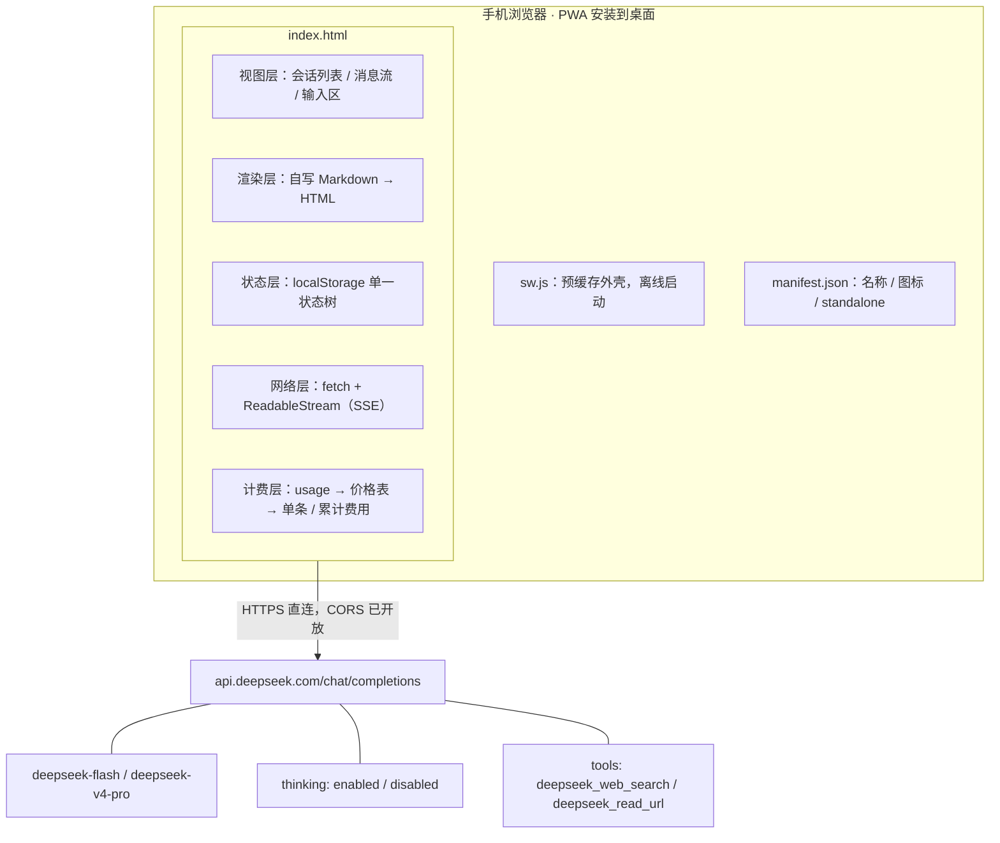

# 架构说明

## 1. 总体结构



没有本地引擎、没有 Node 进程、没有 proot。

## 2. 请求契约

```json
POST /chat/completions
{
  "model": "deepseek-flash",
  "stream": true,
  "stream_options": { "include_usage": true },
  "thinking": { "type": "enabled" },
  "tools": [
    { "type": "deepseek_web_search" },
    { "type": "deepseek_read_url" }
  ],
  "messages": [
    { "role": "system", "content": "…你现在的时间是 …" },
    { "role": "latest_reminder", "content": "2026-11-18,星期三,中国,App,中文" },
    { "role": "user", "content": "今天几号？" },
    { "role": "assistant", "content": "…", "reasoning_content": "…" }
  ]
}
```

要点：

- 声明了服务端工具后，历史里的 `assistant` 消息必须回传 `reasoning_content`，否则 400
- `latest_reminder` 必须紧跟一条 `user` 消息
- 图片消息的 `content` 是块数组：`{type:text}` + `{type:image_url, image_url:{url:dataURL, detail:auto}}`
- 图片只支持 `deepseek-flash`，`deepseek-v4-pro` 无视觉能力

## 3. 流式响应处理

```
data: {"choices":[{"delta":{"reasoning_content":"…"}}]}
data: {"choices":[{"server_tool_event":{"type":"call_started","call":{…}}}]}
data: {"choices":[{"server_tool_event":{"type":"call_completed","call":{"sources":[…]}}}]}
data: {"choices":[{"delta":{"content":"…"}}]}
data: {"choices":[{"delta":{…},"finish_reason":"stop"}]}
data: {"choices":[],"usage":{…}}
data: [DONE]
```

前端逐行解析 `data:`，按 `delta.reasoning_content` / `delta.content` 增量渲染；工具调用事件驱动“正在搜索/阅读”的状态行并收集来源；最后的 `usage` 用于计费。

## 4. 计费

```
费用 = 命中token×命中价 + 未命中token×未命中价 + 输出token×输出价
```

价格按模型与时段（高峰/空闲）查表，单价单位为元/百万 token。高峰判定：北京时间周一至周五 9:00–12:00、14:00–18:00。单条费用存在消息对象上，对话累计由消息汇总。

## 5. 存储

```js
{
  settings: { apiKey, theme, think, search, model, memoryOn, personalOn },
  memories: [{ id, text, ts }],   // 最多 60 条，每条 ≤200 字
  personal: "个性化模板文本",
  convs: [{
    id, title, createdAt, updatedAt,
    msgs: [{ role, content, images?, reasoning?, usage?, cost?, sources?, tools?, ts }]
  }],
  current: "会话 id"
}
```

- 单一 localStorage 键 `qianliao.v2`，整体序列化
- 超配额时先丢弃历史图片再重试，避免写失败
- 图片前端压缩：最长边 1600px，JPEG 0.86

## 5.1 上下文注入顺序

1. system：人设 + 当前时间
2. system 追加：个性化要求（`personalOn` 时）
3. system 追加：长期记忆（`memoryOn` 时，取最近 30 条）
4. 每一轮：`latest_reminder` + user（+ 图片块）

记忆写入有三条路径：

1. 手动在「记忆」面板添加
2. 自动识别命令式说法（`MEM_CMD`：帮我记住、记一下、添加记忆、保存到记忆、备忘…）
3. 自动识别偏好陈述（`MEM_PREF`：我喜欢、我的专业、以后…）

判定分两层：

- `parseMemCommand`：命令词（记住/记一下/添加记忆/存一下/备忘/别忘了/记我…）出现在句中任意位置，取命令词之后的内容；之后内容不足 2 字时取命令词之前的部分
- `looksPersonal`：以「我是/我叫/我住/我喜欢/我习惯/以后/别再…」开头的自我陈述

命令里直接带了内容（如「添加记忆我是安徽人」）会立刻写入并渲染「已存入记忆」标记，不等待 AI 回复；没有内容的（「记住这个」）或自我陈述，则在回复结束后把上下文交给 `deepseek-flash` 抽取，返回 NONE 则不写。写入前用归一化字符重叠度做去重。

## 5.2 国际化

`I18N.zh / I18N.en` 两套文案，`t(key)` 取当前语言；静态节点用 `data-i18n` / `data-i18n-ph` 标记，`applyLang()` 统一刷新并重绘。系统提示词、`latest_reminder`、记忆抽取提示同样按语言切换，因此模型回复语言与界面一致（个性化模板可覆盖）。

## 5.3 主题与排版

CSS 变量集中控制配色与字号：`--fs-msg`、`--fs-code` 由设置里的滑块写入 `document.documentElement`，主题只有墨色/纸色两套，无彩色主色。代码高亮用单次正则扫描（注释、字符串、数字、标识符）生成 `tk-*` 类，不做完整语法分析。

## 5.4 渲染与指标

Markdown 自写解析：先抽出围栏代码、行内代码与数学公式占位，转义后再处理行内样式，最后按行分块（表格、列表、引用、标题、段落）。数学用 KaTeX（`output: html`，字体随包本地缓存），结果按公式字符串缓存。

指标：`usage` 来自 `stream_options.include_usage`；缓存命中率 = `prompt_cache_hit_tokens / prompt_tokens`；输出速率 = 可见输出 token / 首字到末字耗时；上下文占用取最近一次请求的 `prompt_tokens + completion_tokens`，除以 1M 窗口。

## 5.5 启动路径

`applyLang()` → 读取 localStorage → 渲染会话 → 首帧。KaTeX 不在启动链里：只有渲染到公式时才注入脚本（约 275KB），加载完成后扫描 `.math-raw[data-tex]` 原地替换，避免打断流式输出或滚动位置。启动耗时记在 `window.__bootMs`，关于页展示。

## 6. 渲染

自写 Markdown 子集：围栏代码块（带语言标签与复制）、行内代码、粗斜体、删除线、标题、有序/无序列表、引用、分割线、链接。先整体转义再按行分块，避免 XSS。

## 7. 离线

`sw.js` 预缓存 `./`、`index.html`、manifest、图标；导航请求网络优先、失败回落缓存，因此本地静态服务停掉后仍能打开外壳；`navigator.storage.persist()` 降低被回收概率。

## 8. 已知限制

- 法定节假日仍按工作日计算高峰价
- 没有多设备同步、没有推送
- 历史只在本机浏览器，清站点数据会丢
- 图片存 localStorage，数量多时会触发清理
