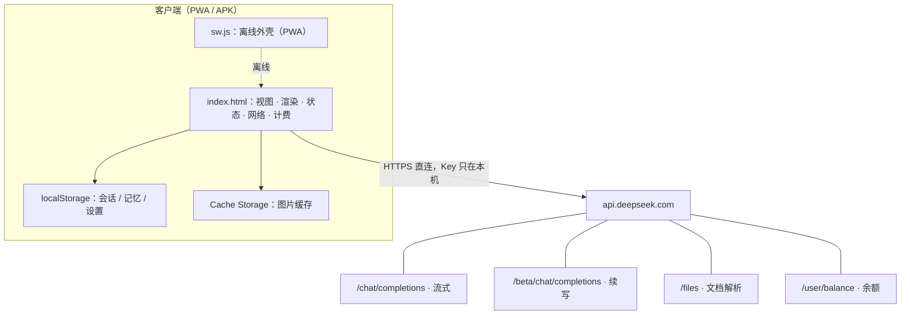

# 轻言 Pico

> 1.2MB 的 DeepSeek 轻客户端。自带 API Key，数据只存本机。
>
> 个人开发版本，与 DeepSeek 官方无关，也不代表官方立场，仅供社区自用与学习参考。
> 针对 2026 年 11 月 DeepSeek C 端限额政策重新设计：不再受每日对话额度、4 万字单次输入、7 天闲置会话失效的限制。

**下载**：[下载页](https://suxiangyu.top/download/) · [Gitee Release](https://gitee.com/suxiangyu138/deepseek-sxy/releases) · [GitHub Release](https://github.com/suxiangyu138/deepseek-sxy/releases)

**源码**：[Gitee](https://gitee.com/suxiangyu138/deepseek-sxy) · [GitHub](https://github.com/suxiangyu138/deepseek-sxy)

  

---

## 一、为什么做这个项目

2026 年 11 月 16 日，DeepSeek 因算力紧张，对 App 与网页版的免费用户收紧用量：

- 单次输入上限压缩到约 4 万字
- 存续超过 7 天且无活跃交互的长对话不再支持接续
- 每日对话额度另设上限，触顶后提示「因服务器繁忙，使用额度已达上限」
- 同期服务稳定性下降，10 月以来多次出现对话服务与 API 中断

而官方的 API 通道是独立规则：按量计费、独立的并发限制，不受 C 端限额影响，模型能力一致，上下文同样支持 1M。

这就产生了一个明显的错位：**同一个模型，走 App 会被限流，走 API 不会。**

DeepSeek_sxy 就是为这个错位准备的客户端：把官方 API 包装成一个接近官方 App 的对话体验，用自己的 Key 直接调用，绕开 C 端配额，同时把对话数据留在本机。

| 维度 | 官方 App / 网页版 | DeepSeek_sxy |
|---|---|---|
| 每日额度 | 有上限，触顶停用 | 无，按 API 用量计费 |
| 单次输入 | 约 4 万字 | 受模型 1M 上下文限制 |
| 闲置会话 | 7 天未活跃可能无法接续 | 永久保留，存在本机 |
| 上下文 | 受限 | 1M，实时显示占用 |
| 数据 | 存在服务端 | 只存本机浏览器或 APK |
| 联网/思考 | 服务端能力 | 同一个服务端工具接口 |

参考报道：

- [DeepSeek 成立以来首次限制免费用户（21 世纪经济报道）](https://m.21jingji.com/article/20261118/9955e792673f679b6ba6e29b0fae1c91.html)
- [DeepSeek 开始限制使用（光明网）](https://m.gmw.cn/2026-11/16/content_1304586782.htm)
- [调用量冲上全球第一，DeepSeek 开始对免费用户限额（央广网）](https://tech.cnr.cn/techds/20261117/t20261117_527875325.shtml)

---

## 二、它是什么

一个纯前端的单页应用，同时提供两种形态：

- **网页 / PWA**：一个 HTML 文件加本地资源，装到桌面即可用
- **安卓 APK**：用 WebView 封装，资源打包进安装包，启动不依赖任何服务

没有后端、没有账号体系、没有中转服务器。所有请求从设备直连 `api.deepseek.com`。

### 功能

- 流式对话，深度思考（`thinking`），联网搜索与阅读链接（服务端工具）
- 图片理解、PDF/Word/PPT 文档解析（Files API）
- 记忆与个性化：聊天里说「记住…」自动归纳，长期生效
- 表格、KaTeX 公式、代码高亮、任务列表、Mermaid 之外的 Markdown 子集
- 会话搜索、置顶、锁定、批量删除、草稿、分页渲染
- 每条回答的缓存命中率、输出速率、费用；顶栏实时上下文占用（/1M）
- 中英双语、字号与整体界面缩放
- 全量备份导出/导入，支持导入 DeepSeek 官方导出的会话 JSON

---

## 三、架构



---

## 四、快速开始

### 方式一：安装 APK

1. 从 Releases 下载最新的 `DeepSeek_sxy-*.apk`
2. 安装时允许「未知来源」
3. 打开后填入自己的 DeepSeek API Key（可在 [platform.deepseek.com](https://platform.deepseek.com/api_keys) 申请）
4. 设置里「测试连接」确认 Key 与余额

### 方式二：iOS

Safari 打开 [网页版](https://suxiangyu.top/app/)，点底部「分享」→「添加到主屏幕」，桌面会出现图标，全屏使用。

不需要开发者账号，也不需要审核。代价是没有推送，且 iOS 会定期清理长期未访问站点的缓存，重新打开时会自动重新拉取。

### 方式三：网页版（桌面 / 其它浏览器）

项目是静态资源，任意静态服务器都能跑：

```bash
cd app && python3 -m http.server 8899
```

浏览器打开后「安装应用 / 添加到主屏幕」。

---

## 五、从源码构建 APK

不依赖 Android Studio 与 Gradle，在 ARM64 的 Ubuntu 上也能出包：

```bash
apt install -y openjdk-17-jdk-headless aapt apksigner zipalign android-sdk-platform-23
# R8 用于生成 dex
curl -O https://maven.aliyun.com/repository/google/com/android/tools/r8/9.5.33/r8-9.5.33.jar

aapt package -f -M AndroidManifest.xml -S res -A app -I android.jar -F base.apk
javac -source 8 -target 8 -bootclasspath android.jar -d classes src/**/MainActivity.java
java -cp r8.jar com.android.tools.r8.D8 --min-api 24 --lib android.jar --output dex classes/**/*.class
# 把 classes.dex 塞进 APK，对齐、签名
zipalign -f 4 base.apk aligned.apk
apksigner sign --ks release.jks --out DeepSeek_sxy.apk aligned.apk
```

---

## 六、项目结构

```
app/                 前端全部资源（单文件 index.html + sw.js + KaTeX）
download/            下载页与隐私说明
docs/                架构、发行、封装方案
apk/                 Android 清单、Java 源码、图标资源
tools/serve.py       本地开发服务器（带 no-store 与 APK MIME）
tools/sync.sh        同步到手机目录
```

---

## 七、自建部署

整套系统是纯静态的，任意静态服务器都能托管。推荐的目录结构：

```
/app/       网页版，iOS 用户添加到主屏幕用的就是它
/download/  下载页、APK、release.json
```

Nginx 需要处理四件事：

1. `/app/index.html` 与 `/app/sw.js` 设为 `Cache-Control: no-store`，避免 CDN 缓存旧版本
2. `.apk` 的 MIME 设为 `application/vnd.android.package-archive`
3. CSP 至少放行 `connect-src 'self' https://api.deepseek.com data: blob:`，同时允许内联脚本与样式
4. APK 使用版本化文件名 `app-X.Y.Z.apk`，`release.json` 指向它，避免固定文件名被 CDN 缓存旧包

`app-latest.apk` 可以保留作固定入口，但页面不要依赖它。

---

## 八、隐私

- API Key、会话、记忆、图片全部保存在本机
- 唯一的外部请求是 `api.deepseek.com`
- 没有统计埋点，没有账号，没有云端同步
- 卸载应用即删除全部数据

详见 [隐私说明](https://suxiangyu.top/download/privacy.html)。

---

## 九、已知限制

- 自定义服务商、云同步不在规划内，保持「单 Key、单机、单用户」
- 网页版依赖 Service Worker，偶尔会缓存旧版本，需要强制刷新
- APK 目前使用系统 WebView，极旧机型上玻璃效果会退化
- iOS 只能通过 Safari 添加到主屏幕，没有独立安装包；缓存可能被系统清理，重新打开会重新加载

---

## 十、版本与发布

当前 v1.9.4，versionCode 13。

- 下载页：[suxiangyu.top/download](https://suxiangyu.top/download/)
- Gitee Release：[releases](https://gitee.com/suxiangyu138/deepseek-sxy/releases)
- GitHub Release：[releases](https://github.com/suxiangyu138/deepseek-sxy/releases)

每次发布在 Release 附 APK 与 SHA-256，变更记录见 [CHANGELOG.md](CHANGELOG.md)。

APK 命名约定为 `Pico-X.Y.Z.apk`，站点上另存一份 `app-X.Y.Z.apk` 供下载页引用。

---

## 十一、许可

本项目以 [MIT](LICENSE) 协议开源，可自由使用、修改、分发，保留版权声明即可。

第三方组件：

- KaTeX — MIT
- 其余依赖均为 Android 系统自带组件

