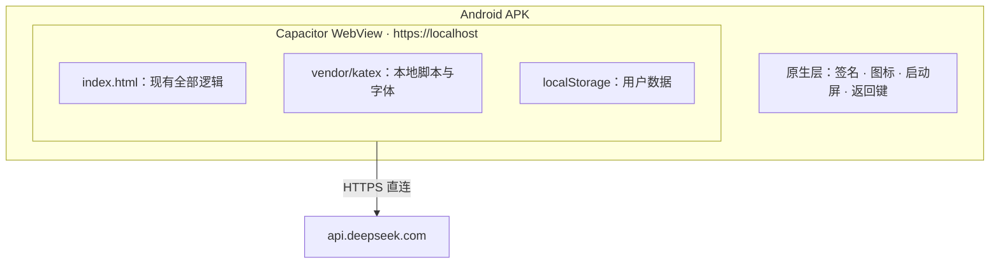

# 轻言 Pico封装与发布技术方案

版本：v1.0（草案）
日期：2026-11-18
适用阶段：自用期结束、准备封装为安卓安装包并发布到 GitHub 时执行

---

## 1. 背景与目标

### 1.1 现状

当前是一套单页 PWA：

- 纯静态资源：`index.html`（内联 CSS/JS）、`sw.js`、`manifest.json`、`vendor/katex`（约 600KB）
- 直接调用 `api.deepseek.com`，无自建后端
- 数据全部存在浏览器 localStorage：API Key、会话、图片、记忆、个性化、设置
- 靠 Service Worker 缓存界面，本地 8899 静态服务只在开发期提供文件
- 已具备：流式对话、深度思考、联网搜索、链接阅读、图片视觉、文档解析、记忆、个性化、双语、字号、语音无

### 1.2 目标

短期（3—6 个月）：只在自己手机上用，继续迭代体验，不对外发布。

长期：把同一套前端代码封装成安卓 APK，发布在 GitHub，用户下载安装即可使用，不需要域名、服务器、备案。

### 1.3 非目标

- 不做服务端代理，不做共享 API Key
- 不做账号体系、云端同步、多设备互通
- 首发不做 iOS，不做上架应用商店

---

## 2. 总体方案

### 2.1 选型对比

| 方案 | 是否需要域名 | 是否需要服务器 | 改造量 | 结论 |
|---|---|---|---|---|
| Capacitor 封装 | 否 | 否 | 小 | 采用 |
| 裸 WebView 手写壳 | 否 | 否 | 中 | 备选 |
| TWA（Bubblewrap） | 是 | 是 | 小 | 排除 |
| PWA 托管 | 是 | 是 | 无 | 排除 |

选择 Capacitor 的理由：

- 现有代码零改动即可运行，UI 逻辑完全复用
- 资源随 APK 打包，启动不依赖任何本地服务
- 自带本地 https 源，localStorage、剪贴板、文件选择、相机、下载都能工作
- 社区成熟，出包路径标准化，便于以后加自动构建

### 2.2 目标架构



没有中转层，没有服务端密钥，没有域名依赖。

---

## 3. 工程结构

```
deepseek-app/                 # 新仓库或现有仓库根目录
├─ app/                       # 现有前端，原样迁入
│  ├─ index.html
│  ├─ sw.js
│  ├─ manifest.json
│  └─ vendor/katex/
├─ capacitor.config.json
├─ package.json
├─ android/                   # cap add android 生成
│  ├─ app/
│  │  ├─ build.gradle
│  │  └─ src/main/AndroidManifest.xml
│  └─ variables.gradle
├─ tools/
│  ├─ sync-web.sh             # 把 app/ 同步进 android/app/src/main/assets/public
│  └─ build-release.sh
└─ docs/
   └─ PACKAGING.md            # 本文档
```

建议：现有 Gitee 仓库继续保存前端与文档，另建一个 GitHub 仓库用于发布，避免把构建产物和签名配置混进已有历史。

---

## 4. 关键改造点

### 4.1 移除对本地 8899 服务的依赖

现在 `index.html` 由 `python3 -m http.server` 提供，封装后由 Capacitor 的本地服务器加载，不需要任何外部服务。改造后 `webDir` 直接指向 `app/`，删除开发期的端口引用即可。

### 4.2 Service Worker 条件禁用

在原生壳里，资源就在本地，SW 只会缓存旧版本，增加更新麻烦。

```js
const isNative = !!window.Capacitor;
if (!isNative && 'serviceWorker' in navigator) {
  navigator.serviceWorker.register('sw.js');
}
```

保留网页版继续用 SW，原生壳里不注册。

### 4.3 源与 CORS

Capacitor 默认把页面跑在 `https://localhost`。DeepSeek 的接口对任意 Origin 都有 CORS 响应（已实测），因此 `fetch` 到 `api.deepseek.com` 不需要额外代理。

需要在 `capacitor.config.json` 里确认：

```json
"server": { "androidScheme": "https" }
```

如果以后接口收紧 CORS，需要退回原生 `CapacitorHttp` 插件转发（会改请求实现，需评估）。

### 4.4 文件与相机

- 拍照：`<input type="file" accept="image/*" capture="environment">`，由系统相机应用处理，不需要 CAMERA 权限
- 相册：`<input type="file" accept="image/*" multiple>`
- 文件：文档 MIME 过滤，交给系统文件选择器

Capacitor 的 WebView 支持 `<input type="file">` 的选择器回调；如果某个版本出现点击无反应，退回 `@capacitor/camera` 插件，或自定义 `WebChromeClient.onShowFileChooser`。

### 4.5 大文件与内存

- 单文件上限 30MB，文档解析在服务端完成
- 图片先压缩为 1280px JPEG 再上传，30 张时降为 1024px
- WebView 中一次性读入超大文件会触发 OOM，保持现有前端限制即可

### 4.6 存储与迁移（重点）

localStorage 的源从 `http://127.0.0.1:8899` 变成 `https://localhost`，**现有数据不会自动迁移**。

在封装前必须先做「导出 / 导入」：

- 导出：把 `{settings, convs, memories, personal}` 序列化成 JSON 文件，用系统分享或下载保存
- 导入：选择 JSON 文件，校验版本号后写回 localStorage
- API Key 是否导出：默认不含，导入后重新填写
- 图片体积大，导出时可选择「含图片 / 仅文字」

建议把图片从 localStorage 迁到 IndexedDB 后再导出，避免 5MB 上限。

### 4.7 返回键

Android 返回键默认会关闭应用。接入 `@capacitor/app`：

- 有抽屉或面板打开 → 关闭
- 在会话页 → 回退到会话列表或最小化
- 再按一次退出

### 4.8 状态栏与安全区

- 使用 `@capacitor/status-bar` 设置浅色/深色图标，跟随主题
- 现有 CSS 已用 `env(safe-area-inset-*)`，原生层开启 edge-to-edge 后需真机确认
- Android 15 默认强制 edge-to-edge，需在主题里配置透明状态栏

---

## 5. 构建环境

### 5.1 Windows 本机

| 组件 | 版本 | 说明 |
|---|---|---|
| Node.js | 20 LTS+ | 运行 Capacitor CLI |
| JDK | 17 | Gradle 要求 |
| Android Studio | 最新稳定版 | 自带 SDK 与模拟器 |
| Android SDK | Platform 35、Build-Tools 35 | 编译目标 |
| Gradle | 由 wrapper 提供 | 不单独安装 |

### 5.2 初始化命令

```bash
npm init -y
npm i @capacitor/core
npm i -D @capacitor/cli
npm i @capacitor/android
npx cap init "轻言 Pico" "com.suxiangyu.deepseek" --web-dir=app
npx cap add android
npx cap sync
```

### 5.3 构建命令

```bash
cd android
./gradlew assembleDebug      # 调试包
./gradlew assembleRelease    # 正式包
```

产物路径：

- `android/app/build/outputs/apk/debug/app-debug.apk`
- `android/app/build/outputs/apk/release/app-release.apk`

---

## 6. 签名与版本管理

### 6.1 生成密钥（只做一次）

```bash
keytool -genkeypair -v -keystore qianliao-release.jks \
  -alias qianliao -keyalg RSA -keysize 2048 -validity 10000
```

要求：

- 文件与密码单独备份，不提交到任何仓库
- 放在仓库外的目录，构建时通过环境变量传入
- 丢失后无法覆盖升级，用户只能卸载重装

### 6.2 gradle 配置

在 `android/app/build.gradle` 中读取环境变量：

```gradle
signingConfigs {
  release {
    storeFile file(System.getenv("QL_KEYSTORE") ?: "release.jks")
    storePassword System.getenv("QL_STORE_PASS")
    keyAlias System.getenv("QL_KEY_ALIAS")
    keyPassword System.getenv("QL_KEY_PASS")
  }
}
buildTypes {
  release {
    signingConfig signingConfigs.release
    minifyEnabled false
    shrinkResources false
  }
}
```

### 6.3 版本号规则

`versionName`：语义化，当前 1.6.0。
`versionCode`：`主*10000 + 次*100 + 修订`，例如 1.6.0 → 10600，1.7.2 → 10702。

每次发版两者同时递增，避免安装覆盖失败。

---

## 7. 图标与启动屏

- 用 1024×1024 的一张大图，通过 `@capacitor/assets` 生成各密度图标
- Android 8+ 使用自适应图标：前景放头像，背景用 `#f5f5f7` 纯色
- 启动屏背景与界面一致，避免现在网页版里旧缓存导致的深色闪屏
- 状态栏图标颜色随主题切换

---

## 8. 发布流程

### 8.1 手动发布

1. 改版本号
2. `npx cap sync`
3. `./gradlew assembleRelease`
4. 用 `apksigner` 或 Gradle 自动签名
5. 计算 SHA-256，写入 Release 说明
6. 在 GitHub 新建 Release，附上 APK
7. 更新下载页的二维码与版本号

### 8.2 自动发布（后续）

GitHub Actions：

```yaml
name: build-apk
on:
  push:
    tags: ['v*']
jobs:
  build:
    runs-on: ubuntu-latest
    steps:
      - uses: actions/checkout@v4
      - uses: actions/setup-java@v4
        with: { distribution: temurin, java-version: '17' }
      - uses: actions/setup-node@v4
        with: { node-version: '20' }
      - run: npm ci
      - run: npx cap sync android
      - run: cd android && ./gradlew assembleRelease
      - uses: softprops/action-gh-release@v2
        with:
          files: android/app/build/outputs/apk/release/app-release.apk
        env:
          GITHUB_TOKEN: ${{ secrets.GITHUB_TOKEN }}
```

签名密钥与密码放进仓库 Secrets，构建时还原 keystore 文件。

### 8.3 发布合规

- 只放自签名 APK，用户安装时需允许「未知来源」，在下载页写清步骤
- 仓库里附 `PRIVACY.md`：Key 与对话只存本机、不上传服务器
- 附第三方许可：KaTeX（MIT）、字体（随 KaTeX 分发）

---

## 9. 质量保障

### 9.1 真机测试清单

| 项目 | 验证点 |
|---|---|
| 启动 | 冷启动 ≤2s，无黑屏，加载层正常消失 |
| 对话 | 流式输出、停止、重新生成、复制全文、Markdown |
| 渲染 | 表格横向滑动、公式、任务列表、代码高亮 |
| 附件 | 拍照、相册 30 张、PDF/Word 解析、失败提示 |
| 记忆 | 自动识别、去重、开关 |
| 个性化 | 模板注入、中英文切换 |
| 设置 | Key 测试、余额、字号滑块、主题 |
| 数据 | 杀进程后重开、重启手机后重开 |
| 异常 | 飞行模式、弱网、超大回答、超长代码 |

### 9.2 灰度

先自己用一周，再给 2—3 个同学试装，收集崩溃日志（可用 `adb logcat` 临时抓取）。

---

## 10. 风险与应对

| 风险 | 影响 | 应对 |
|---|---|---|
| 签名密钥丢失 | 无法覆盖升级 | 双备份到离线介质与密码管理器 |
| WebView 版本过低 | 玻璃效果退化、部分 API 不可用 | minSdk 26，真机覆盖测试 |
| 数据未迁移 | 用户原有对话丢失 | 先做导出/导入再切换 |
| 图片占用过大 | 存储超限 | 迁移 IndexedDB，限制单会话图片数 |
| CORS 收紧 | 请求失败 | 备选 CapacitorHttp 原生转发 |
| 大文件上传 OOM | 应用崩溃 | 前端限制 30MB，分片后续再做 |
| 商店审核 | 无法上架 | 首发只走 GitHub，后续再评估 |

---

## 11. 里程碑

| 阶段 | 内容 | 产出 |
|---|---|---|
| M0 | 自用期，继续迭代 PWA | 现有网页版 |
| M1 | 导出 / 导入功能 | 数据可迁移 |
| M2 | 图片迁移 IndexedDB | 存储稳定 |
| M3 | Capacitor 工程与 debug 包 | 可安装的测试包 |
| M4 | 签名、图标、启动屏 | 正式 APK |
| M5 | GitHub Release + Actions | 可公开下载 |
| M6 | 文档、隐私声明、试用反馈 | 对外可用 |

预估：M3 约 1 天，M4 约 1 天，M5 约半天，M1—M2 各半天。

---

## 12. 后续演进

- iOS：Capacitor 同一套工程可直接加 iOS 平台，需要 Mac 或云构建
- 桌面端：Electron 或 Tauri 套同一份前端
- 自动更新：应用内读取 GitHub Release 的最新版本号，提示下载
- 图片存储：IndexedDB + 导出打包 ZIP
- 语音：接入 ASR/TTS 接口
- 多模型：增加服务商切换（需处理各自的鉴权和工具差异）

---

## 13. 附：速查清单

构建前检查：

- [ ] 版本号已递增
- [ ] `npx cap sync` 已执行
- [ ] keystore 路径与密码通过环境变量传入
- [ ] 未把密钥写进代码或配置
- [ ] 图标与启动屏为新版本
- [ ] 真机安装一次，覆盖安装一次

发布前检查：

- [ ] APK 已签名，`apksigner verify` 通过
- [ ] SHA-256 已记录
- [ ] Release 说明写清版本与改动
- [ ] 下载页与二维码指向新版本
- [ ] 隐私说明存在
